<!-- The gallery: one slide per layout of COMPONENTS.md. Copy a slide, change the words.
     Figures: figures/make_figures.py. Render: ../tools/render.sh gallery.md png -->

<!-- _class: title -->
<!-- _paginate: false -->
<!-- _footer: "" -->
<!-- Layout: title (cover). h1 = one or two words in the black box, h2 = the rest, one word .hot,
     the paragraph after h2 = the black band (one line). -->

# Softmax

## and its rounding <span class="hot">errors</span>

When float32 rounds the gradient to zero

<p class="by">Sadamori Kojaku</p>

<div class="art">

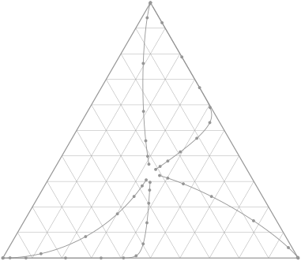

</div>

---

<!-- _class: agenda -->
<!-- Layout: agenda. An ordered list; repeat it before each part with at-N to grey the others. -->

## Outline

1. Softmax and cross-entropy
2. The logit margin
3. Rounding in float32
4. A formula that keeps the gradient

---

<!-- _class: divider -->
<!-- Layout: divider (first slide of a part). crumb = the deck title; art = grey line art, optional. -->

<p class="crumb">Softmax rounding errors</p>

## Softmax and cross-entropy

<div class="art">


</div>

---

<!-- Layout: lead + one large diagram (pattern D1 in COMPONENTS.md). -->

## One training step

The model outputs logits, softmax turns them into probabilities, and the gradient of the cross-entropy updates the parameters.

<div class="fig">

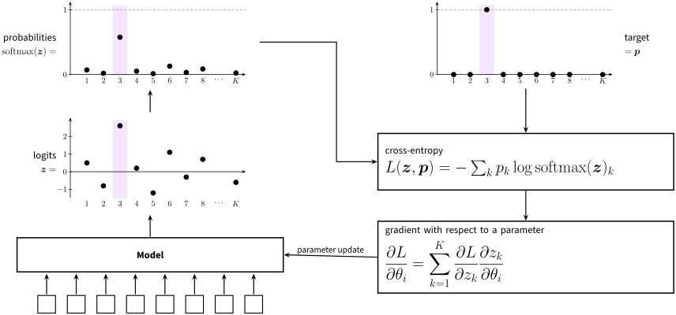

</div>

---

<!-- Layout: definition line, two tab boxes joined by a thick arrow (left), before/after dot plots with triangles (right). -->

## Softmax and its standard implementation

Softmax turns the logits $\vb z = [z_1, \dots, z_K]$ into a probability distribution. The standard implementation subtracts the largest logit first, because $e^{z}$ overflows float32 for $z > 88.7$.

<div class="cols c11">
<div>

<div class="box" data-tab="Probabilities">

$$\softmax(\vb z)_k = \frac{e^{z_k}}{\sum_{j=1}^{K} e^{z_j}}$$

<div class="note">

$e^{z}$ is larger than the largest float32 number ($3.4\times 10^{38}$) when $z > 88.7$.

</div>
</div>

<div class="darrow r"></div>

<div class="box" data-tab="Standard implementation">

With $z_{\max} = \max_j z_j$ and $\tilde z_k = z_k - z_{\max}$,

$$\softmax(\vb z)_k = \frac{e^{\hl{\tilde z_k}}}{\sum_{j=1}^{K} e^{\hl{\tilde z_j}}}$$

<div class="note">

The order of the logits is kept, and the largest one becomes 0, so no exponent is positive.

</div>
</div>

</div>
<div class="cols flow mid">

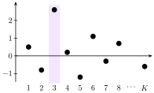

<span class="tri"></span>

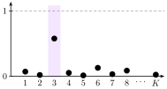

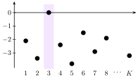

<span class="tri"></span>


</div>
</div>

---

<!-- Layout: left = definition + tab box with bullets + two small figures with captions;
     right = a tall tab box with a derivation, reasons on the right (\why), highlights (\hl). -->

## The logit margin

The logit margin $m$ is how far the target logit $z_t$ is above the other logits. The target probability is a function of $m$ alone.

<div class="cols c11">
<div>

<div class="def">

Target logit: $z_t$

</div>

<div class="box" data-tab="Logit margin">

$$m = z_t - \log \sum_{j \neq t} e^{z_j}$$

- $\log \sum_j e^{z_j}$ is a smooth version of $\max_j z_j$
- $m$ is how far $z_t$ is above the other logits

</div>

<div class="cols c11">
<div class="fig">
<p class="figtitle">A clear winner</p>

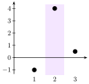

<div class="cap">

$m = 4 - \log(e^{-1} + e^{0.5}) \approx 3.299$

</div>
</div>
<div class="fig">
<p class="figtitle">A near tie</p>

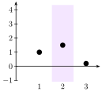

<div class="cap">

$m = 1.5 - \log(e^{1} + e^{0.2}) \approx 0.129$

</div>
</div>
</div>

</div>
<div>

<div class="box eq-sm" data-tab="The target probability in terms of the margin">

$$
\begin{aligned}
e^{-m} &= e^{-z_t + \log \sum_{j\neq t} e^{z_j}} && \why{(definition of $m$)}\\
&= e^{-z_t} \sum_{j\neq t} e^{z_j} && \why{($e^{a+b} = e^a e^b$, $e^{\log x} = x$)}\\
&= \hl{\sum_{j\neq t} e^{z_j - z_t}}
\end{aligned}
$$

$$
\begin{aligned}
\softmax(\vb z)_t &= \frac{e^{z_t}}{e^{z_t} + \sum_{j\neq t} e^{z_j}}\\
&= \frac{1}{1 + \hl{\sum_{j\neq t} e^{z_j - z_t}}}\\
&= \frac{1}{1 + e^{-m}} = \sigmoid(m)
\end{aligned}
$$

</div>
</div>
</div>

---

<!-- Layout: two definitions on one line, a tab box, then two boxes joined by a triangle (.cols.flow.stretch). -->

## Derivative of the loss

The derivative of the cross-entropy with respect to the logits is $\vb q - \vb p$, where $\vb q = \softmax(\vb z)$.

<div class="def">

Logits: $\vb z = [z_1, \dots, z_K]$ <span class="gap"></span> Target: $\vb p = [p_1, \dots, p_K]$

</div>

<div class="cols c11">
<div class="box" data-tab="Cross-entropy">

$$L(\vb z, \vb p) = -\sum_{k} p_k \log \softmax(\vb z)_k$$

</div>
</div>

<div class="cols flow stretch">
<div class="box eq-sm" data-tab="Derivative with respect to a logit">

$$
\begin{aligned}
g_j = \frac{\partial L}{\partial z_j} &= -\sum_{k=1}^{K} p_k \left(\delta_{kj} - q_j\right)\\
&= -\sum_{k=1}^{K} p_k \delta_{kj} + q_j \sum_{k=1}^{K} p_k\\
&= q_j - p_j
\end{aligned}
$$

</div>

<span class="tri"></span>

<div class="box eq-sm">

For a hard target (1 for the target class $t$, 0 for the others), $\vb p$ is one-hot:

$$\vb p = [0, \dots, 0, 1, 0, \dots, 0]$$

The derivatives are then

$$g_t = q_t - 1 \qquad g_j = q_j \quad (j \neq t)$$

</div>
</div>

---

<!-- Layout: a box split into formula | bullets; a second box with a title row (.span), two plots and a text column.
     .ref = the full reference of what the slide is about. -->

## Adam (Kingma & Ba 2015)

Adam divides each step by a running estimate of the gradient size, so the step hardly depends on how large the gradient is.

<div class="box split c11 mid" data-tab="Adam update">
<div class="center">

$$\theta_i \leftarrow \theta_i - \eta\,\frac{\hat m_i}{\sqrt{\hat v_i} + \epsilon}$$

</div>
<div>

- $\eta$: learning rate
- $\hat m_i$: first moment (recent mean of the gradient)
- $\hat v_i$: second moment (recent mean of the squared gradient)
- the step is large when the sign of the gradient is stable

</div>
</div>

<div class="box split norule c111 mid">
<p class="figtitle span">Adam moves both parameters at about the same speed</p>
<div class="fig">

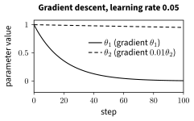

</div>
<div class="fig">

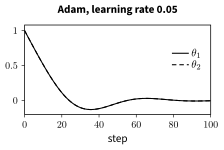

</div>
<div>

For the loss

$$L = \tfrac{1}{2}\left(\theta_1^2 + 0.01\,\theta_2^2\right)$$

- gradient descent: each step scales with the gradient
- Adam: each step is about $\eta$, whatever the gradient size

</div>
</div>

<div class="ref">Kingma, D. P., & Ba, J. (2015). Adam: A method for stochastic optimization. International Conference on Learning Representations.</div>

---

<!-- _class: agenda at-3 -->
<!-- Layout: the agenda again before part 3; at-3 greys every other item. -->

## Outline

1. Softmax and cross-entropy
2. The logit margin
3. Rounding in float32
4. A formula that keeps the gradient

---

<!-- Layout: code box, grey output box with an indented note, bullets (left); derivation with a note (right);
     an overlay leader line from the output to the formula (coordinates from tools/check.py --boxes). -->

## Softmax collapse in float32

When the target logit is much larger than the others, the standard cross-entropy rounds the target gradient to 0.

<div class="cols c32">
<div>

<div class="def">

With $\vb z = [9, -9, -9]$ and $\vb p = [1, 0, 0]$:

</div>

```python
import numpy as np
z = np.array([9.0, -9.0, -9.0], dtype=np.float32)
p = np.array([1.0, 0.0, 0.0], dtype=np.float32)
e = np.exp(z - z.max())
q = e / e.sum()
print(q - p)                # gradient with respect to z
```

<div class="out" id="out">

```output
[0.0000000e+00 1.5229979e-08 1.5229979e-08]
```

The exact value is $[-3.046\times10^{-8},\ 1.523\times10^{-8},\ 1.523\times10^{-8}]$; the target entry is lost.

</div>

- it happens when $z_t$ is much larger than every other logit
- $z_t$ stops moving, while the other logits keep moving

</div>
<div>

$$
\begin{aligned}
g_t &= q_t - p_t = q_t - 1\\
&= \htmlId{frac}{\hl{\frac{1}{1 + e^{-m}}}} - 1
\end{aligned}
$$

<div class="note">

Here $m = 18 - \log 2 \approx 17.3$ and $e^{-m} \approx 3.0\times10^{-8}$. In float32, $1 + e^{-m}$ rounds to 1 once $e^{-m} < 2^{-24}$, that is, once $m > 24 \log 2 \approx 16.6$.

</div>
</div>
</div>

<svg class="overlay" viewBox="0 0 1280 720"><circle cx="568" cy="414" r="5"/><line x1="568" y1="414" x2="836" y2="226"/></svg>

---

<!-- Layout: two data figures stacked (left), grouped bullets centred vertically (right). -->

## Training loss and logit margin

In these synthetic curves, the standard loss jumps each time the mean margin reaches 16.6, and the fixed loss does not.

<div class="cols c32">
<div class="fig">
<p class="figtitle">Training loss</p>

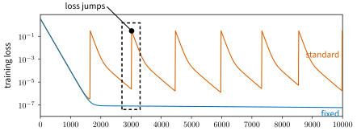

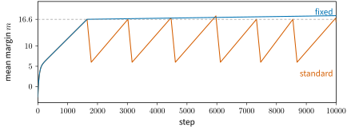

<p class="figtitle">Mean logit margin</p>
</div>
<div class="vcenter">

- standard cross-entropy
  - the loss falls to $10^{-7}$, then jumps to $10^{-1}$
  - each jump comes when the margin reaches $16.6$
  - after the jump, the margin falls to about 6

- fixed cross-entropy
  - the loss stays near $10^{-7}$
  - the margin keeps growing past $16.6$

<p class="note muted">The curves are synthetic, made by figures/make_figures.py to show the figure style.</p>

</div>
</div>

---

<!-- Layout: a formula split into parts with tags above and pins below, then a figure with callouts. -->

## Two formulas for the target gradient

The two formulas are equal in exact arithmetic. The second keeps the small number $e^{-m}$ in the numerator, where float32 has a fine grid.

<div class="parts eq-lg">
<div class="part">

$$g_t =$$

</div>
<div class="part" data-tag="standard">

$$\hl{\frac{1}{1 + e^{-m}}} - 1$$

<div class="pin">

For $m > 16.6$ the fraction rounds to 1, and $g_t$ becomes 0.

</div>
</div>
<div class="part">

$$=$$

</div>
<div class="part" data-tag="fixed">

$$-\,\hlc{\frac{e^{-m}}{1 + e^{-m}}}$$

<div class="pin">

The denominator still rounds to 1, but the numerator keeps its value.

</div>
</div>
</div>

<div class="fig push">

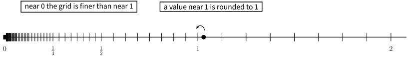

</div>

---

<!-- Builds: the same slide repeated, one more thing marked each time (mark on a bullet, \hl on a formula,
     .hl on a block). Nothing moves between builds. This is build 1 of 3. -->

## Why the loss jumps

After many steps of near-zero gradients, Adam takes a full-size step on the first nonzero gradient.

<div class="eqrow eq-lg" data-label="parameter update">

$$\theta_i \leftarrow \theta_i - \eta\,\frac{\hat m_i}{\sqrt{\hat v_i} + \epsilon} - \eta\lambda\theta_i$$

</div>

<div class="eqrow" data-label="moment updates">
<div class="cols c11">
<div>

$$m_i \leftarrow \beta_1 m_i + (1-\beta_1)\,\frac{\partial L}{\partial \theta_i}$$

$$\hat m_i = \frac{m_i}{1-\beta_1^{\tau}}$$

</div>
<div>

$$v_i \leftarrow \beta_2 v_i + (1-\beta_2)\left(\frac{\partial L}{\partial \theta_i}\right)^2$$

$$\hat v_i = \frac{v_i}{1-\beta_2^{\tau}}$$

</div>
</div>
</div>

- as the model fits the training data, $m$ grows and $q_t$ approaches 1
- for an example with $m > 16.6$, $g_t = 0$ and every other $g_j$ is a small positive number
- once every example has $m > 16.6$, the gradient is near 0, and $\hat m_i$ and $\hat v_i$ decay
- when a few examples fall below $16.6$ again, $\hat m_i / (\sqrt{\hat v_i} + \epsilon)$ jumps
- the large step raises the loss

---

<!-- Build 2 of 3: the moment updates and bullet 3 are marked. -->

## Why the loss jumps

After many steps of near-zero gradients, Adam takes a full-size step on the first nonzero gradient.

<div class="eqrow eq-lg" data-label="parameter update">

$$\theta_i \leftarrow \theta_i - \eta\,\frac{\hat m_i}{\sqrt{\hat v_i} + \epsilon} - \eta\lambda\theta_i$$

</div>

<div class="eqrow" data-label="moment updates">
<div class="cols c11">
<div class="hl">

$$m_i \leftarrow \beta_1 m_i + (1-\beta_1)\,\frac{\partial L}{\partial \theta_i}$$

$$\hat m_i = \frac{m_i}{1-\beta_1^{\tau}}$$

</div>
<div class="hl">

$$v_i \leftarrow \beta_2 v_i + (1-\beta_2)\left(\frac{\partial L}{\partial \theta_i}\right)^2$$

$$\hat v_i = \frac{v_i}{1-\beta_2^{\tau}}$$

</div>
</div>
</div>

- as the model fits the training data, $m$ grows and $q_t$ approaches 1
- for an example with $m > 16.6$, $g_t = 0$ and every other $g_j$ is a small positive number
- <mark>once every example has $m > 16.6$, the gradient is near 0, and $\hat m_i$ and $\hat v_i$ decay</mark>
- when a few examples fall below $16.6$ again, $\hat m_i / (\sqrt{\hat v_i} + \epsilon)$ jumps
- the large step raises the loss

---

<!-- Build 3 of 3: the step term is highlighted and labelled; bullet 4 is marked. -->

## Why the loss jumps

After many steps of near-zero gradients, Adam takes a full-size step on the first nonzero gradient.

<div class="eqrow eq-lg" data-label="parameter update">

$$\theta_i \leftarrow \theta_i - \overset{\why{this term jumps}}{\hl{\eta\,\frac{\hat m_i}{\sqrt{\hat v_i} + \epsilon}}} - \eta\lambda\theta_i$$

</div>

<div class="eqrow" data-label="moment updates">
<div class="cols c11">
<div>

$$m_i \leftarrow \beta_1 m_i + (1-\beta_1)\,\frac{\partial L}{\partial \theta_i}$$

$$\hat m_i = \frac{m_i}{1-\beta_1^{\tau}}$$

</div>
<div>

$$v_i \leftarrow \beta_2 v_i + (1-\beta_2)\left(\frac{\partial L}{\partial \theta_i}\right)^2$$

$$\hat v_i = \frac{v_i}{1-\beta_2^{\tau}}$$

</div>
</div>
</div>

- as the model fits the training data, $m$ grows and $q_t$ approaches 1
- for an example with $m > 16.6$, $g_t = 0$ and every other $g_j$ is a small positive number
- once every example has $m > 16.6$, the gradient is near 0, and $\hat m_i$ and $\hat v_i$ decay
- <mark>when a few examples fall below $16.6$ again, $\hat m_i / (\sqrt{\hat v_i} + \epsilon)$ jumps</mark>
- the large step raises the loss

---

<!-- Layout: a figure on a white panel (as a figure quoted from a paper), a bold figure title above, the source
     below, and notes under the figure joined to points in it by overlay leader lines. -->

## A quoted figure with notes

A figure taken from a paper sits on a white panel, with its source under it and the notes below it.

<p class="figtitle">The standard loss jumps back up; the fixed loss does not</p>

<div class="fig">
<div class="panel">


</div>
<p class="cap">Synthetic curves. A quoted figure gets its source here, e.g. "Figure 2 of Author et al. (2026)".</p>
</div>

<div class="cols c111" style="margin: 14px 40px 0">
<p class="small" id="n1"><b>Before the first jump</b><br>both losses fall at the same rate</p>
<p class="small" id="n2"><b>A jump</b><br>the standard loss rises to about 0.3</p>
<p class="small" id="n3"><b>The fixed loss</b><br>stays near its minimum</p>
</div>

<svg class="overlay" viewBox="0 0 1280 720"><circle cx="462" cy="275" r="5"/><line x1="462" y1="275" x2="170" y2="438"/><circle cx="635" cy="208" r="5"/><line x1="635" y1="208" x2="540" y2="438"/><circle cx="811" cy="335" r="5"/><line x1="811" y1="335" x2="900" y2="438"/></svg>

---

<!-- Layout: one box in sections: a header row, a full-width rule (<hr>), then columns with a grey rule
     between them (.split); chips for short items; a grey box and an inline tag. -->

## A box in sections

A box can hold a header row, a rule across it, and columns separated by grey rules.

<div class="box">

### Softmax with temperature

$\softmax(\vb z / T)$ is flat for a large $T$ and puts all mass on $\argmax_k z_k$ as $T \to 0$.

<hr>

<div class="split c12 mid">
<div class="center">

$$q_k = \frac{e^{z_k/T}}{\sum_j e^{z_j/T}}$$

</div>
<div>

- $T = 1$: the usual softmax
- $T \to \infty$: $q_k \to 1/K$ for every $k$
- $T \to 0$: $q_k \to 1$ for the largest logit, $0$ for the others

</div>
</div>
</div>

<div class="cols c11">
<div class="box">

### Where $T$ appears

<span class="chip">distillation</span><span class="chip">sampling</span><span class="chip">contrastive loss</span><span class="chip">annealing</span>

</div>
<div class="box grey">

### Two names for one thing <span class="tag">aside</span>

The inverse temperature $\beta = 1/T$ is used in physics; machine learning uses $T$.

</div>
</div>

---

<!-- Layout: label-cell rows (.kv) around a Markdown table; the header row is hidden. -->

## Notation

The symbols used in this deck.

<div class="kv">

| symbol | meaning |
|---|---|
| $\vb z = [z_1, \dots, z_K]$ | logits, one per class |
| $\vb q = \softmax(\vb z)$ | predicted probabilities |
| $\vb p$ | target distribution; one-hot for a hard target |
| $m$ | logit margin of the target class $t$ |
| $g_j = \partial L / \partial z_j$ | derivative of the loss with respect to logit $j$ |

</div>

---

<!-- Layout: text only. Grouped bullets (a blank line between groups), one claim per group in .key. -->

## Two rounding problems in softmax

The standard formulas for softmax and cross-entropy run into float32 limits at both ends of the range of $e^{z}$.

<div class="vcenter">

- **Overflow** at large logits
  - $e^{z}$ is larger than the largest float32 number when $z > 88.7$
  - <span class="key">subtracting $\max_j z_j$ before the exponential avoids it</span>

- **Collapse** at a large margin
  - $1 + e^{-m}$ rounds to 1 when $m > 16.6$, so the target gradient $g_t$ becomes 0
  - <span class="key">writing $g_t$ with $e^{-m}$ in the numerator keeps it</span>

</div>

---

<!-- _class: roomy -->
<!-- Layout: summary. Nested bullets, no figure; roomy = larger text when a slide has room. -->

## Summary

- softmax and cross-entropy are computed in float32, which has a fine grid near 0 and a coarse grid near 1
  - $\softmax(\vb z)_t = \sigmoid(m)$, with $m$ the logit margin
  - $g_t = q_t - 1$ rounds to 0 once $m > 24 \log 2 \approx 16.6$
- with Adam, a long run of zero target gradients ends in a large step
  - $\hat m_i$ and $\hat v_i$ decay while the gradient is near 0
  - the first nonzero gradient after that gives a step of about $\eta$
- the formula $g_t = -e^{-m} / (1 + e^{-m})$ is equal in exact arithmetic and keeps $g_t$ in float32
