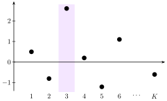

<!-- A slide deck. Before writing slides, write the wireframe (SKILL.md step 1): for every
     slide its title (a topic) and its lead (the claim, one sentence). Copy further slides from
     ../gallery/gallery.md (path relative to the skill). Render: tools/render.sh deck.md png -->

<!-- _class: title -->
<!-- _paginate: false -->
<!-- _footer: "" -->

# Topic

## in a few words

The subtitle in one line

Author Name

---

<!-- _class: agenda -->

## Outline

1. First part
2. Second part
3. Third part

---

<!-- _class: divider -->

Deck title

## First part

---

## The topic of this slide

One sentence that states what this slide shows, with the symbols it uses, such as $\vb z = [z_1, \dots, z_K]$.

$$\softmax(\vb z)_k = \frac{e^{z_k}}{\sum_{j=1}^{K} e^{z_j}}$$

One fact about the formula that the reader needs.

- a short fragment about it
- another one, with <mark>the marked phrase</mark> if the slide is about it

What the figure shows

---

<!-- _class: roomy -->

## Summary

- the first result
  - its condition
- the second result
